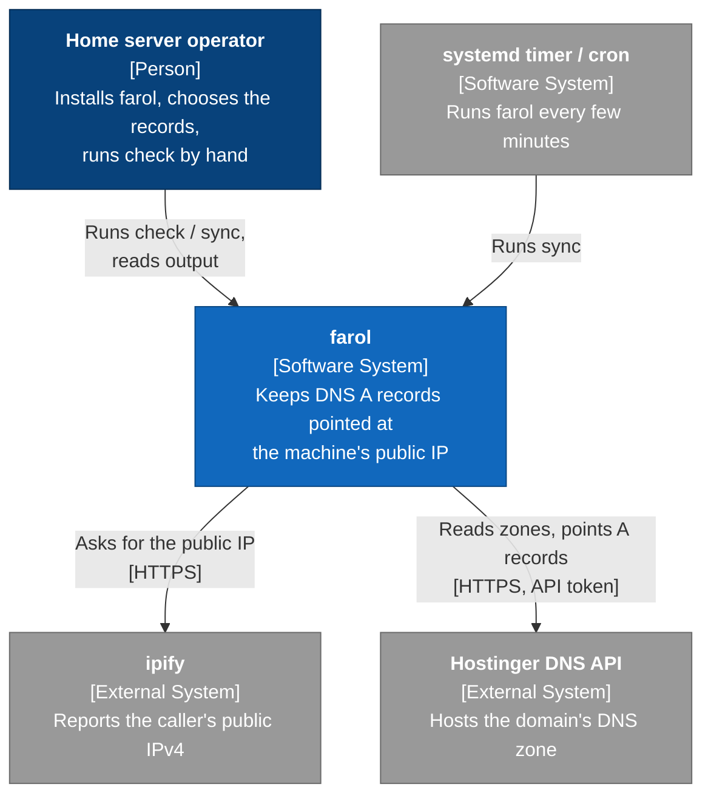
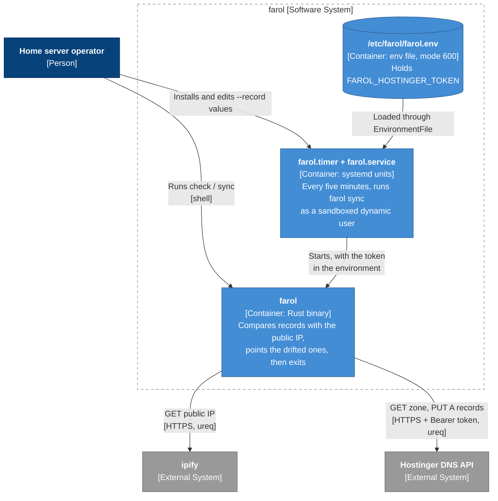
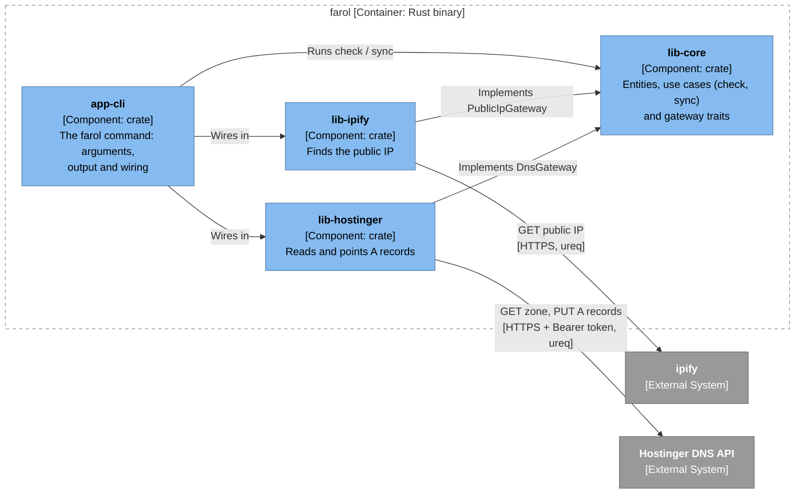

# farol

*Farol* is Portuguese for "lighthouse": it keeps telling the world where you
are. farol keeps DNS A records pointed at the machine's current public IP, so a
home server stays reachable when the ISP changes the address.

It runs once and exits. Schedule it with a systemd timer or cron.

- **DNS providers:** Hostinger.
- **Public IP source:** [ipify](https://www.ipify.org).
- **Records:** IPv4 (A) only.

## Install

Straight from the repository, without cloning it first:

```sh
cargo install --locked --git https://github.com/GabrielVander/farol app-cli
```

Add `--tag <tag>` or `--rev <commit>` to pin a version instead of taking the
latest `main`. Run the same command with `--force` to upgrade.

Or from a local clone:

```sh
cargo install --locked --path crates/app-cli
```

Either way, this installs the `farol` binary into `~/.cargo/bin`.

## Configure

1. Create a Hostinger API token in hPanel under **Profile → API**.
2. Export it. The token is not an argument because other users on the machine
   can read a process's arguments:

   ```sh
   export FAROL_HOSTINGER_TOKEN=...
   ```

## Use

```sh
farol check --provider hostinger --record example.com:home   # show drift, change nothing
farol sync --provider hostinger --record example.com:home    # point drifted records at the public IP
```

| Option | Meaning |
|--------|---------|
| `--provider` | The DNS provider. Required. `hostinger` is the only one so far. |
| `--record DOMAIN:NAME` | A record to keep pointed at this machine. Required and repeatable. Use `@` as the name for the domain itself, and `*` or `*.home` for a wildcard. Quote wildcards so the shell leaves them alone: `--record 'example.com:*'`. |
| `--ttl SECONDS` | The TTL every tracked record should have. Defaults to 300, so a record with any other TTL counts as drifted unless you pass its value here. |

```
$ farol sync --provider hostinger --record example.com:@ --record example.com:home
public IP 203.0.113.7
example.com: unchanged
home.example.com: pointed (was 198.51.100.4, TTL 300)
```

A record has **drifted** when its A records are anything other than exactly
the public IP (missing, different, or several) or its TTL differs from
`--ttl`. Pointing a record replaces all
of its A records with a single one holding the public IP and the `--ttl` value.
Other record types and other names are left alone.

### Exit status

| Status | Meaning |
|--------|---------|
| `0` | Every record is unchanged, drifted (`check`) or pointed (`sync`). |
| `1` | A record failed, the public IP couldn't be found, a record or TTL is invalid, or the token is missing. Details go to stderr. |
| `2` | The command line is wrong, for example no `--record`. |

## Run on a schedule with systemd

[`contrib/systemd`](contrib/systemd) has a hardened service and a timer that
runs `farol sync` every five minutes. The service runs as an unprivileged
dynamic user with no write access anywhere. Edit the `--record` values in
`farol.service` before installing it.

```sh
sudo install -m 755 ~/.cargo/bin/farol /usr/local/bin/farol
sudo install -d /etc/farol
sudo install -m 600 /dev/null /etc/farol/farol.env
echo 'FAROL_HOSTINGER_TOKEN=...' | sudo tee /etc/farol/farol.env >/dev/null
sudo install -m 644 contrib/systemd/farol.service contrib/systemd/farol.timer /etc/systemd/system/
sudo systemctl daemon-reload
sudo systemctl enable --now farol.timer
```

To check that it's working:

```sh
systemctl list-timers farol.timer
journalctl -u farol.service
```

Hostinger allows 90 API requests per minute. farol reads each domain's zone
once per run, so a five-minute schedule stays far below that limit.

### Or with cron

```cron
FAROL_HOSTINGER_TOKEN=...
*/5 * * * * /usr/local/bin/farol sync --provider hostinger --record example.com:home
```

## Architecture

The diagrams follow the [C4 model](https://c4model.com), zooming in one level
at a time. The crate diagram under [Development](#development) is the third
level, the components inside the `farol` binary.

**System context.** farol and the people and systems it works with.



**Containers.** What runs and what stores data when farol is installed with
the systemd units from [`contrib/systemd`](contrib/systemd).



## Development

farol tracks stable Rust through `rust-toolchain.toml`. See
[`CLAUDE.md`](CLAUDE.md) for the engineering rules: Clean Architecture with
vertical slices, lightweight DDD, Clean Code and Canon TDD.

```sh
cargo test --workspace
cargo clippy --workspace --all-targets
cargo llvm-cov --workspace
```

| Crate | Role |
|-------|------|
| `lib-core` | Entities, use cases (check, sync) and gateway traits |
| `lib-ipify` | Finds the public IP through ipify |
| `lib-hostinger` | Reads and points A records through Hostinger's DNS API |
| `app-cli` | The `farol` command: arguments, output and wiring |

A new DNS provider is a new slice crate that implements `DnsGateway`.

**Components.** The third C4 level: the crates inside the `farol` binary.
Every arrow points inward, toward `lib-core`. The core defines the gateway
traits, the slice crates implement them, and only `app-cli` knows about all of
them.



`lib-core-testing` isn't in the diagram because it isn't in the binary. It
holds the fakes and fixtures the tests share, and only `lib-core` and `app-cli`
depend on it, as a dev-dependency.

### Project layout

```
farol/
├── .github/workflows/ci.yml          # CI: fmt, clippy, tests
├── contrib/systemd/                  # hardened service and five-minute timer
│   ├── farol.service
│   └── farol.timer
├── crates/
│   ├── lib-core/                     # the domain: no I/O, no third-party APIs
│   │   ├── src/
│   │   │   ├── entities/             # domain_name, label, public_ip, record_name, tracked_record, ttl
│   │   │   ├── use_cases/
│   │   │   │   ├── ports/            # dns_gateway, public_ip_gateway
│   │   │   │   ├── check_records.rs
│   │   │   │   ├── sync_records.rs
│   │   │   │   └── report.rs
│   │   │   ├── entities.rs
│   │   │   ├── use_cases.rs
│   │   │   └── lib.rs
│   │   └── tests/                    # check_records, sync_records
│   ├── lib-core-testing/             # fakes and fixtures shared by the tests
│   │   └── src/                      # fakes, fixtures, lib
│   ├── lib-ipify/                    # PublicIpGateway through ipify
│   │   └── src/
│   │       ├── adapters/             # ipify_api, ipify_public_ip_gateway
│   │       └── infrastructure/       # ureq_ipify_api
│   ├── lib-hostinger/                # DnsGateway through Hostinger's DNS API
│   │   └── src/
│   │       ├── adapters/             # hostinger_api, hostinger_dns_gateway, models
│   │       └── infrastructure/       # ureq_hostinger_api
│   └── app-cli/                      # the `farol` binary
│       ├── src/
│       │   ├── adapters/
│       │   │   ├── controllers/      # record_arguments, records_controller
│       │   │   └── presenters/       # record_arguments_view, report_view
│       │   ├── infrastructure/       # command_line, run, token
│       │   ├── lib.rs
│       │   └── main.rs
│       └── tests/farol.rs            # end-to-end tests of the binary
├── Cargo.toml                        # workspace
├── rust-toolchain.toml
├── CLAUDE.md
├── LICENSE
└── README.md
```

## Licence

MIT
